# eva-terminal

Evangelion-themed terminal dashboards for Linux — a **GPU-server login banner + live monitor** and a **laptop / desktop banner**, in five units: EVA-00, EVA-01, EVA-02, Mark.06 and EVA-08. Pure Python 3 standard library, no root, no daemons.

[中文说明](#中文说明)

| EVA-02 · GPU server | EVA-00 · local machine |
|---|---|
| 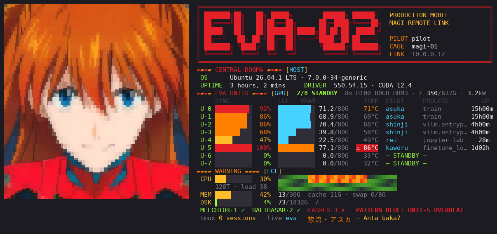 | 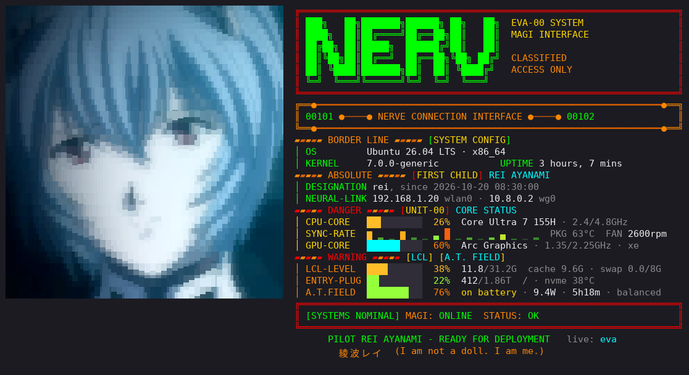 |

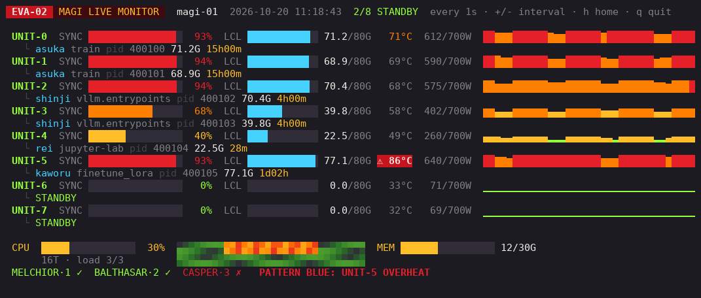

*Screenshots use the built-in demo data (`EVA02_DEMO=1`, `EVA00_DEMO=1`) — no real server was harmed.*

## Units

Every unit works with both layouts; it changes colours, lettering, pilot and quote — never the data. Alerts (overheat, load colours) look the same in every unit.

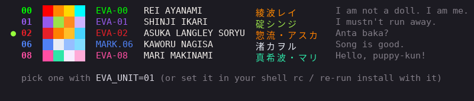

#### `00` · EVA-00 — Rei Ayanami · *"I am not a doll. I am me."*
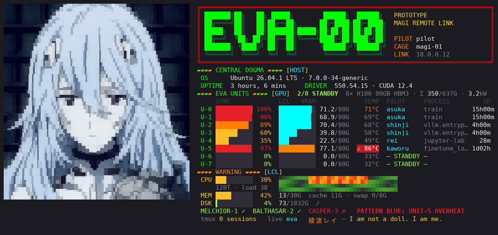

#### `01` · EVA-01 — Shinji Ikari · *"I mustn't run away."*
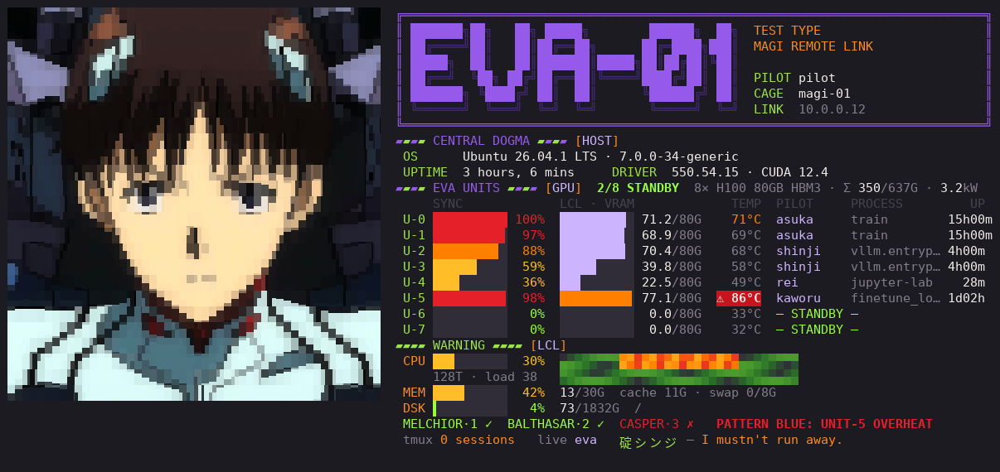

#### `02` · EVA-02 — Asuka Langley Soryu · *"Anta baka?"*
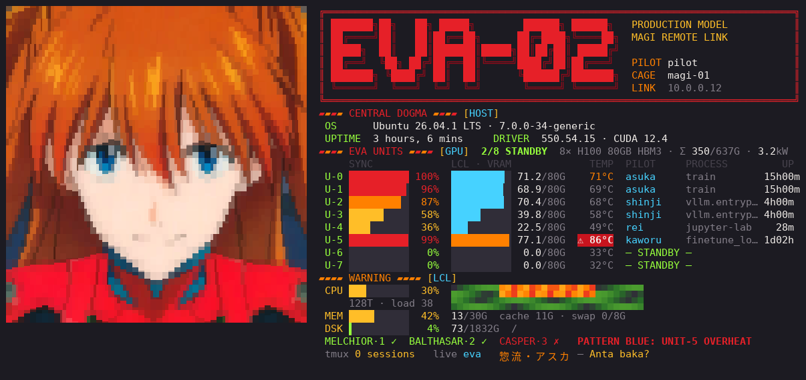

#### `06` · Mark.06 — Kaworu Nagisa · *"Song is good."*
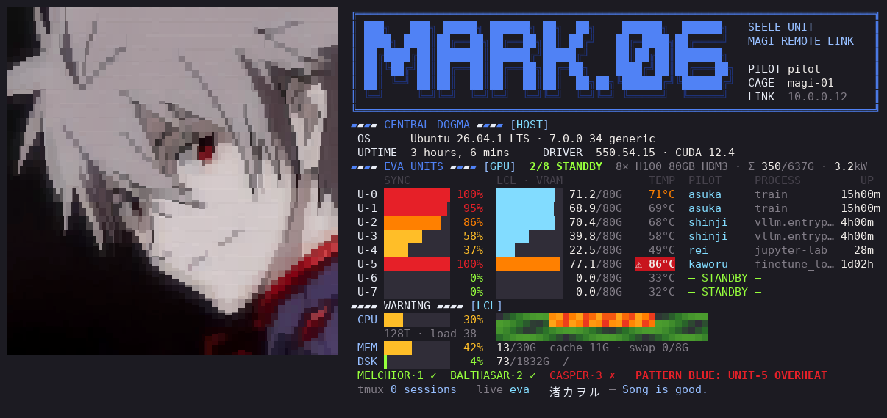

#### `08` · EVA-08 — Mari Makinami · *"Hello, puppy-kun!"*
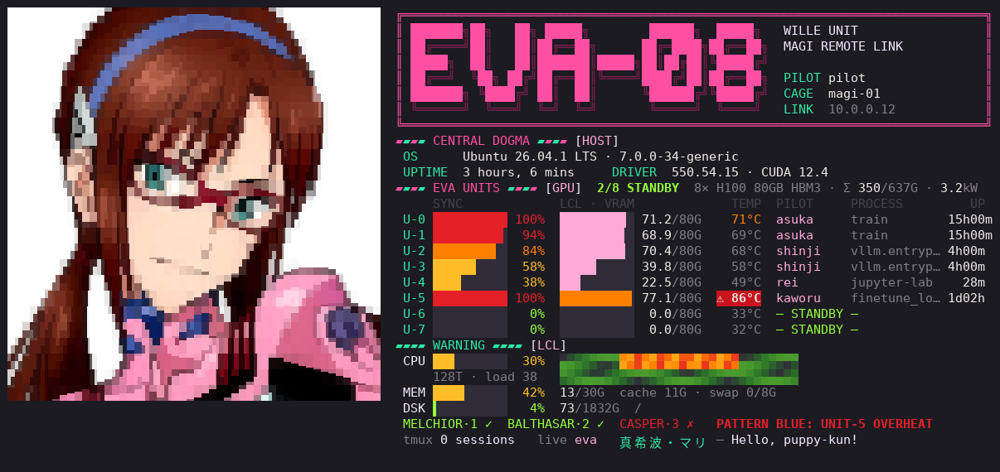

<details>
<summary><b>The same five units on the local layout</b></summary>

#### `00` · EVA-00 · NERV
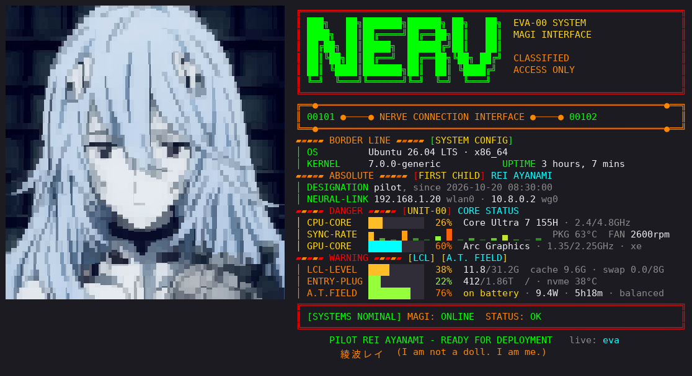

#### `01` · EVA-01 · NERV
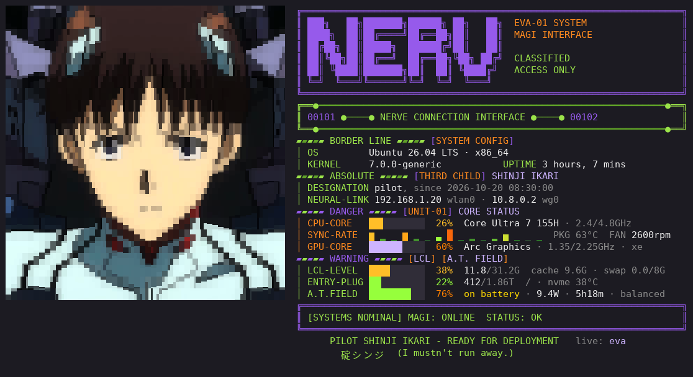

#### `02` · EVA-02 · NERV
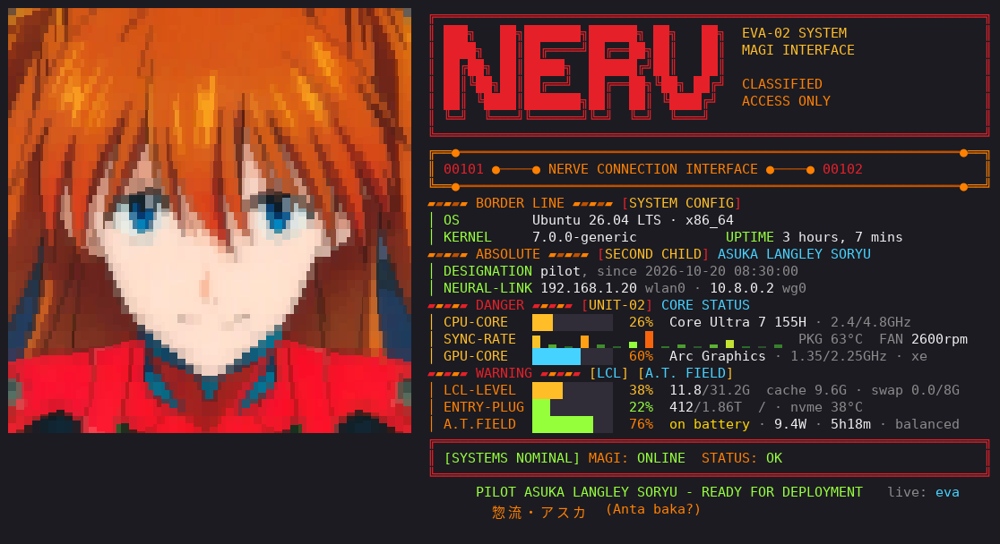

#### `06` · Mark.06 · SEELE
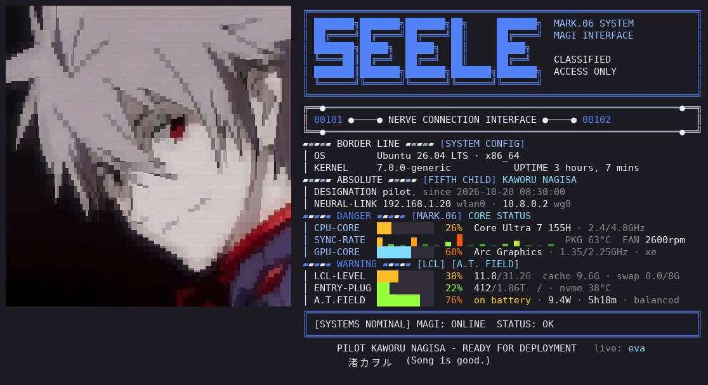

#### `08` · EVA-08 · WILLE
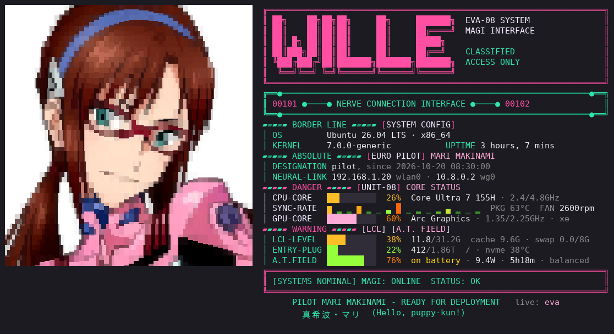

</details>

Switch any time with `EVA_UNIT=01 eva`, or install with a unit (below). Default: EVA-02 on servers, EVA-00 locally. Every unit ships with an avatar of its pilot; swap in your own any time ([own avatar](#use-your-own-avatar)).

## Features

**Server layout — for shared GPU servers (`server/`, command `eva02`)**
- Login banner: per-GPU utilisation **and VRAM** bars, temperature, who is running what and for how long, total VRAM / power, a 1-cell-per-2-cores CPU heatmap, memory, disk.
- `eva` — the same page, refreshing in place every second (`+`/`-` interval, `d` detail view, `q` quit).
- `magi` (or `asuka`) — detail view: every process with PID, power draw, utilisation sparkline per GPU.
- MAGI verdict line: flags overheating GPUs (*PATTERN BLUE*), no free GPUs, nearly-full disk.
- Starship prompt with a host badge in the unit's colour and a cached `▣ free/total` GPU segment; tmux status bar with the same summary.
- Banner shows only for interactive logins — `scp`, `rsync`, VS Code Remote are untouched.

**Local layout — for your own machine (`local/`, command `eva00`)**
- Keeps the NERV look (fastfetch-style) but live: real CPU %, per-core load bars, CPU package temperature, fan, Intel iGPU frequency, memory, disk + NVMe temperature, battery with power draw and time left, network links and throughput.
- `eva` / `rei` — live-refreshing view.

Both pick the largest avatar that fits your terminal width (50 → 26 columns) and drop it on narrow terminals.

## Install

```bash
git clone https://github.com/Clearailhc/eva-terminal && cd eva-terminal

# GPU server (over ssh; installs starship to ~/.local/bin if missing, backs up ~/.bashrc / ~/.tmux.conf / starship.toml)
EVA02_NAME=h100 server/install.sh user@gpu-server              # EVA02_NAME = short name shown in banner / prompt / tmux
EVA_UNIT=01 EVA02_NAME=h100 server/install.sh user@gpu-server  # …as EVA-01 (prompt and tmux colours follow)

# this machine (zsh or bash; backs up your rc file)
local/install.sh
EVA_UNIT=06 local/install.sh                                   # …as Mark.06
```

Requirements: Linux, Python ≥ 3.8; `nvidia-smi` on the GPU server. A [Nerd Font](https://www.nerdfonts.com/) for the prompt glyphs.

Try it without a GPU: `EVA02_DEMO=1 EVA_AVATARS=share/units bin/eva02` (add `EVA_UNIT=08`, or run `bin/eva02 units`).

Uninstall: delete the block between `# >>> eva02 >>>` / `# >>> eva00 >>>` and its `<<<` line in your rc file, and `~/.local/bin/eva0{0,2}`.

## Use your own avatar

```bash
tools/img2ansi.py picture.jpg -o ~/.local/share/eva-terminal/units/01 --crop 380,40,940,600 --gamma 0.78
```

Writes `avatar-{50,44,40,32,26}.ans` for that unit (crop a square around the face; `--gamma < 1` lifts dark frames without blowing out highlights). Each terminal cell is matched against 21 block glyphs (halves, quadrants, eighths), chafa-style, which keeps far more edge detail than plain half-blocks. For a server, write to `share/units/<unit>/` in the repo and re-run `server/install.sh`.

## Configuration

| Variable | Default | |
|---|---|---|
| `EVA_UNIT` | `02` server · `00` local | theme: `00` `01` `02` `06` `08` |
| `EVA02_NAME` | short hostname | name in banner, prompt, tmux, tab title |
| `EVA02_HOT` | `80` | °C at which a GPU is flagged |
| `EVA02_TTL` | `10` | seconds the prompt / tmux GPU summary is cached |
| `EVA_AVATARS` | `~/.local/share/eva-terminal/units` | avatars, one folder per unit |

## Layout

```
bin/eva02            engine (units, widgets, live loop) + server banner / live views
bin/eva00            local banner (imports bin/eva02 as its engine)
share/units/<unit>/  avatars
server/              install.sh, bashrc snippet, starship.toml + tmux.conf templates
local/               install.sh, shell snippet
tools/img2ansi.py    image → ANSI avatar converter
tools/ansi2png.py    renders ANSI output to PNG (used for the screenshots)
```

## Disclaimer

Unofficial fan project, not affiliated with khara, Inc. or GAINAX. *Neon Genesis Evangelion*, its characters and names are © khara / GAINAX. The bundled ANSI avatars are fan renderings of the characters; if you are a rights holder and want them removed, open an issue and they will be taken down. The code is MIT-licensed; the avatar files are not covered by that license.

---

## 中文说明

EVA 主题的 Linux 终端面板，两种布局，五台机体可选：零号机、初号机、二号机、Mark.06、八号机。

- **服务器布局**（默认二号机）：给共享 GPU 服务器用。登录横幅显示每张卡的算力和显存条、温度、谁在跑什么任务、跑了多久，加上 CPU 核心热力图、内存和磁盘。`eva` 打开实时刷新版，`magi` 打开详细面板。GPU 过热、没有空闲卡、磁盘快满时，MAGI 会给出告警。配套 starship prompt（机体颜色的主机徽标 + 空闲 GPU 数）和 tmux 状态栏。
- **本机布局**（默认零号机）：给自己的电脑用。保留 NERV 风格，实时显示 CPU 占用、每个核的负载、温度、风扇、核显频率、内存、磁盘、电池功耗和剩余时间、网络。`eva` / `rei` 打开实时版。

机体只改变配色、大标题、驾驶员和台词，不影响显示的数据；告警颜色在所有机体里都一样。`bin/eva02 units` 查看全部机体，`EVA_UNIT=01 eva` 临时切换。五台机体的效果见上方 [Units](#units)。

纯 Python 标准库实现，不需要 root。

```bash
EVA02_NAME=h100 server/install.sh user@gpu-server              # 安装到 GPU 服务器
EVA_UNIT=01 EVA02_NAME=h100 server/install.sh user@gpu-server  # 用初号机主题安装
local/install.sh                                               # 安装到本机
```

换成自己的头像：`tools/img2ansi.py 图片 -o ~/.local/share/eva-terminal/units/01 --crop 左,上,右,下 --gamma 0.78`

非官方粉丝作品。角色和名称版权归 khara / GAINAX。仓库附带的字符画头像不在 MIT 许可范围内，版权方要求时会移除。
